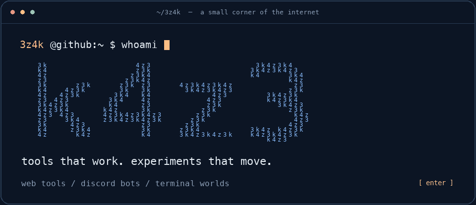
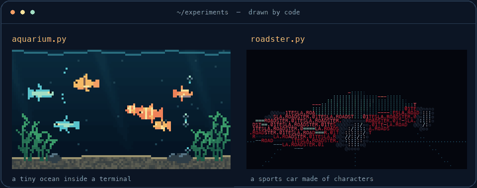

<picture>
  <source media="(prefers-reduced-motion: reduce)" srcset="./assets/intro.png">
  
</picture>

### I build useful things. Then I see what else they can do.

Hey, I'm **k4z3** — `3z4k` here. I make web tools, Discord bots, and little
worlds that live inside a terminal.

Sometimes that means wiring up DNS records. Sometimes it means making a sports
car out of text. Both are good reasons to open an editor.

### Things you can actually use

| Project | What it does | Built with |
| :--- | :--- | :--- |
| **[FractalDash](https://github.com/3z4k/FractalDash)** | A home for Minecraft server subdomains, with Discord sign-in and Cloudflare DNS. | Node.js · Express · EJS · SQLite |
| **[WOS-DISCORD](https://github.com/3z4k/WOS-DISCORD)** | A Discord bot for Whiteout Survival, including automatic gift-code claims. | Discord automation |

### Things I made because I could

<picture>
  <source media="(prefers-reduced-motion: reduce)" srcset="./assets/terminal-lab.png">
  
</picture>

**A tiny ocean. A car made of characters.** These are local Python experiments;
the previews above come from their actual renderers.

Also in the experiment folder: a blooming terminal flower and a heart that
breaks into falling letters. Apparently a terminal can have feelings.

### What I reach for

`Python` · `JavaScript` · `Node.js` · `Express` · `SQLite` · `Cloudflare API` · `Discord`

<details>
<summary><b>One more command?</b></summary>

```console
$ cat philosophy.txt
make it useful.
make it interesting.
see what happens.

$ ls ideas/
one-more-side-project/
```

</details>

---

[Explore my repositories](https://github.com/3z4k?tab=repositories) ·
[Follow the experiments](https://github.com/3z4k)
